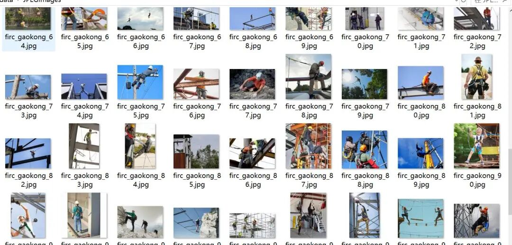
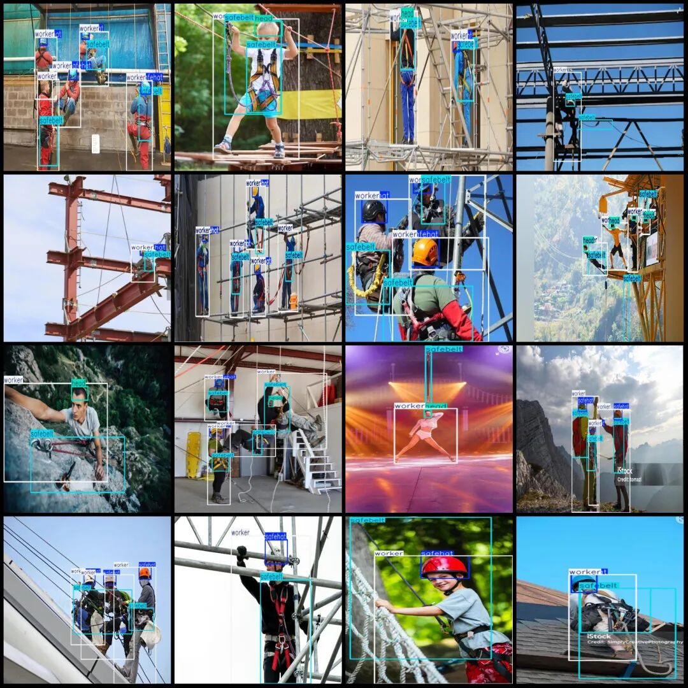
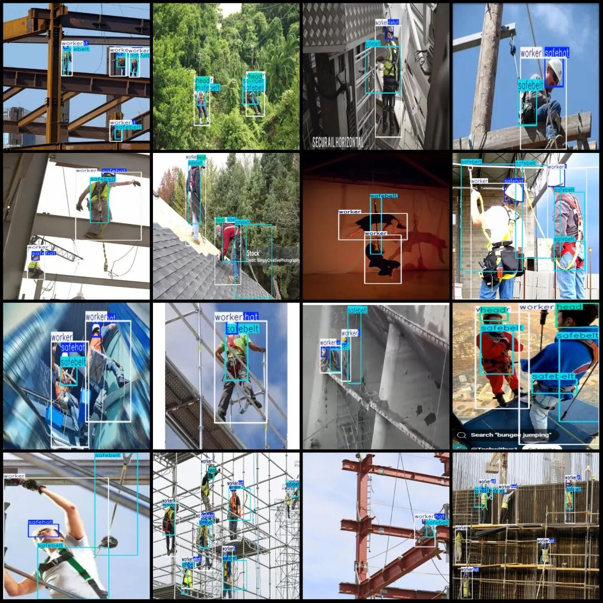

# Worker Safety Belt and Headgear Inspection Data Set in VOC+YOLO format with 110 images across 4 categories

Dataset format: Pascal VOC format + YOLO format (txt file without split path, only containing jpg images and corresponding VOC format xml files and yolo format txt files)

Number of images (number of jpg files): 110

Number of annotations (number of xml files): 110

Number of annotations (number of txt files): 110

Labeling category count: 4

Label category names (Note that the order of categories in the YOLO format does not correspond to this, but is based on the labels folder's classes.txt): ["head", "safebelt", "safehat", "worker"]

Number of boxes labeled in each category:

Head (frame) count = 55

safebelt (safety belt) frame count = 257

Safehat (safety hat) Frame Count = 160

Worker (worker) Frames = 230

Total frame count: 702

Image resolution: Multi-resolution images, such as 804x351, 640x640, etc.

Using labelImg:

Annotation rules: Draw a rectangle around the category.

Important Notice: The dataset does not have separate training, validation, and test sets; you need to partition them yourself.

Special : This dataset does not guarantee the accuracy of the trained models or weight files.

Image Preview:

Annotation example:

## Payment

Here is a pay link on Stripe ( https://buy.stripe.com/3cs8yP7sY87d0vu9AB ). Please contact me lonlonago@foxmail.com after funding $89, and I will send you a complete data files , thank you!

